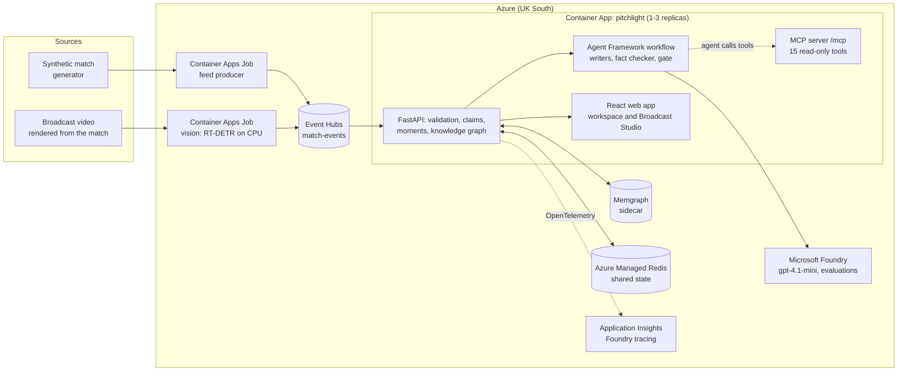

<p align="center">
  
</p>

<h1 align="center">Pitchlight</h1>

<p align="center">
  <b>AI football commentary you can put on air: every statement is verified before anyone sees it.</b>
</p>

<p align="center">
  <a href="https://pitchlight.mangograss-8c9a0131.uksouth.azurecontainerapps.io"></a>
  <a href="https://youtu.be/85Qid7SmMdw"></a>
  <a href="https://github.com/othniel74/pitchlight/actions/workflows/ci.yml"></a>
  
  
  <a href="LICENSE"></a>
</p>

[](https://m8ven.ai/mcp/othniel74-pitchlight-1ybblg?s=readme)

<p align="center">
  <a href="https://pitchlight.mangograss-8c9a0131.uksouth.azurecontainerapps.io">Live demo</a> ·
  <a href="https://youtu.be/85Qid7SmMdw">Video (1:49)</a> ·
  <a href="#who-it-helps">Who it helps</a> ·
  <a href="#how-to-use-it">How to use it</a> ·
  <a href="docs/EVALUATION.md">Evaluation results</a> ·
  <a href="docs/SUBMISSION.md">Submission</a> ·
  <a href="#roadmap">Roadmap</a> ·
  <a href="docs/README.md">Documentation</a>
</p>

Broadcasters, studios and fan apps want AI that explains a match live, in any language. They cannot put it on screen, because language models invent scorers, results and causes. Pitchlight lets agents write and **code verify**: a fact-checking agent extracts every statement, plain code checks each one against the match events, and anything unsupported is sent back or blocked. Nothing unverified is published.

- **Proven live:** 62 of 63 agent-written recaps published across 7 languages, the other blocked safely; 0 wrong statements let through in 264 live fact checks; Microsoft Foundry groundedness 4.71 / 5. Methods and limits: [EVALUATION.md](docs/EVALUATION.md).
- **Ready for real data:** checked offline on 2,669 real matches from two providers, with every score matching (the product itself runs on synthetic data).
- **Built on Azure:** Microsoft Foundry and Agent Framework agents that use Pitchlight's own MCP tools, Event Hubs, Container Apps scaling from 1 to 3 replicas on Azure Managed Redis, Azure AI Speech, managed identity throughout.

## Try the core idea in 60 seconds

1. Open the [demo](https://pitchlight.mangograss-8c9a0131.uksouth.azurecontainerapps.io) and choose **See it in 60 seconds**.
2. In **Try to fool the fact checker**, enter a false claim such as *"Calderbrook won thanks to a hat-trick"*. Read the verdict and its explanation.
3. Press **AI recap**, then open the run to inspect the draft, the extracted claims and their verdicts.

## What the demo shows

- **Simulated matches:** the clubs, players and events are fictional. This makes the demo repeatable and gives the checks a known match record.
- **Commentary and evidence:** explore key moments, statistics and recaps, then inspect why a claim passed or failed.
- **Two ways to run:** with Azure configured, agents write and check recaps. Without Azure settings, the local app uses verified templates; this does not demonstrate live AI writing.
- **A separate video pipeline:** video analysis recovers events from rendered synthetic footage and compares them with known labels. The main commentary experience can run directly from match events without video analysis.

Personalization, broadcast overlays and tactical analysis extend this core experience. The architecture and supporting evaluations appear below.

| | |
| --- | --- |
| **Live demo** | https://pitchlight.mangograss-8c9a0131.uksouth.azurecontainerapps.io (no sign-in, read-only, synthetic data) |
| **Video (1:49, narrated)** | [https://youtu.be/85Qid7SmMdw](https://youtu.be/85Qid7SmMdw) (also in the repo: [docs/demo/pitchlight-submission.mp4](docs/demo/pitchlight-submission.mp4)) |
| **MCP server** | `https://pitchlight.mangograss-8c9a0131.uksouth.azurecontainerapps.io/mcp` (add `?seed=N` for another match) |
| **Submission** | [docs/SUBMISSION.md](docs/SUBMISSION.md): pitch, category and testing instructions |

All clubs (Calderbrook FC, Merridge Athletic), players and events are fictional and synthetic. Pitchlight is not affiliated with the Premier League.

<table>
  <tr>
    <td width="36%"></td>
    <td width="64%"></td>
  </tr>
  <tr>
    <td><sub>A false claim is blocked, with the reason for each statement.</sub></td>
    <td><sub>The match workspace: verified moments, Ask the match, and AI recaps.</sub></td>
  </tr>
</table>

## Who it helps

Language models write well but invent facts, so nobody can put them on screen. Pitchlight checks every statement first. Here is what that changes for each kind of user.

**Broadcasters**

| Today | With Pitchlight | Proof |
| --- | --- | --- |
| AI writes fast, but invents scorers and results. One wrong line on air costs trust. | Every statement is checked against the match before anyone sees it. | 0 false statements in 264 live checks |
| Every AI-written line still needs a person to check it. | Editors review the evidence behind each claim instead of rewriting copy. | Every claim links to its source events |
| Each new language means a new team and a new cost. | One set of verified facts, published in seven languages. | Including Arabic, right to left |

**Fan apps**

| Today | With Pitchlight | Proof |
| --- | --- | --- |
| Every fan gets the same generic match report. | A personal story: your club, your player, the metric you care about. | Fan, analyst or broadcast mode |
| Fans' questions go unanswered, or a chatbot guesses. | Ask the match, and the answer comes from verified data. | A Foundry agent calling Pitchlight's own tools |
| Content arrives after the moment has passed. | Moments and recaps update while the match is being played. | Streamed live through Azure Event Hubs |

**Clubs**

| Today | With Pitchlight | Proof |
| --- | --- | --- |
| At half-time, analysts scrub through video to find what is going wrong. | Pressing, defensive shape and passing changes, in seconds. | Last 15 minutes compared with the 15 before |
| Did the substitution work, or was it just a lucky spell? | The ten minutes before and after every change, ranked against the match's normal swings. | Evidence for the next decision, never a claimed cause |
| Match reports for a global fanbase take hours. | Verified recaps in seven languages, minutes after the final whistle. | 62 of 63 AI recaps published, none wrong |

**Developers**

| Today | With Pitchlight | Proof |
| --- | --- | --- |
| Your own AI agents make up sports facts. | Fifteen verified, read-only match tools any agent can call. | MCP server and HTTP API |
| Every data provider uses a different format. | One validated data layer for events from any provider. | 2,669 real matches checked, every score matched |
| It is hard to prove AI output is safe. | Measured results and an audit trail for every published claim. | Microsoft Foundry groundedness 4.71 / 5 |

## Evaluation results

Measured live on Microsoft Foundry unless marked offline. Full method, per-run tables and known limits: **[docs/EVALUATION.md](docs/EVALUATION.md)**.

| Area | Result | Report |
| --- | --- | --- |
| AI recaps through the multi-agent workflow (3 × 21, 7 languages) | **62 / 63 published**, 1 blocked, 0 published with an error | [json](docs/validation/recap-pass-rate.json) |
| Fact checker on three held-out sets (264 checks) | **0 wrong statements let through**; 93–100% correct | [test](fact-check-test.json) · [h2](fact-check-holdout2.json) · [h3](fact-check-holdout3.json) |
| Foundry release evaluation (Azure AI Evaluation) | **Groundedness 4.71 / 5**, 100% of numbers verified | [json](foundry-eval-report.json) |
| Offline evaluation, 5 seeds (runs in CI) | **56 / 56** checks | [json](evaluation-report.json) |
| Vision vs ground truth (751 frames) | Calibration 3 cm, players 87%, events 87.5% precision | [json](vision-report.json) |
| Real data, offline: 64 World Cup matches (StatsBomb) | **81,931 events, 0 rejected**, 64 / 64 scores | [json](docs/validation/statsbomb-wc2022.json) |
| Real data, offline: 2,605 matches (Sportmonks) | **2,605 / 2,605 scores** match | [json](docs/validation/sportmonks-2024-25.json) |
| Scaling: 80 concurrent viewers | 1 → 3 replicas, **11,016 requests, 0 errors** | [json](docs/validation/load-test-scaled.json) |
| Failover: feed leader killed mid-match | 1,079 accepted, 0 rejected, 0 duplicates | [doc](docs/PATH_TO_PRODUCTION.md) |

## What makes it different

1. **Auto-eventing from video, scored against perfect ground truth.** Pitchlight renders its synthetic match as broadcast video. A vision pipeline then recovers players, ball, passes, goals and speeds from the pixels alone: pitch-line camera calibration, RT-DETR player detection, team and identity tracking, and ball tracking. Real footage has no exact labels; synthetic video does, so every stage is measured:

   | Stage | Result |
   | --- | --- |
   | Camera calibration | 3 cm |
   | Players detected | 87% |
   | Team / identity | 98% / 79% |
   | Events | 87.5% precision, goal found |
   | Pass speed | within 2.6 km/h |

   It runs as an Azure Container Apps Job that streams the recovered events through Event Hubs into the live app. See [VISION.md](docs/VISION.md).
2. **Agents that investigate, write and check one another.** Each recap starts with a researcher agent that decides which of Pitchlight's MCP tools to call and chooses the angle; code turns its choices into facts. A Microsoft Agent Framework workflow then writes narratives and recaps, and a fact-checking agent extracts every statement for **code** to verify, in any of 7 languages. Live results: 0 wrong statements let through in 264 checks, and 62 of 63 live recaps across 7 languages published, with the researcher choosing each angle. Under every AI recap, the run is visible step by step: each agent's draft and every statement with code's verdict.
3. **Agents that use tools through MCP.** Pitchlight serves its verified match intelligence as an MCP server with 15 read-only tools. A Foundry agent answers viewers' questions by calling those tools, so the answer shown is the tool's verified result, never the model's own text. Copilot, Claude Desktop or any other MCP client can use the same tools.
4. **A knowledge graph of everything verified.** It links events, possessions, players, moments and claims. It powers "Why this moment?", pass-network roles (hub, key link, PageRank), xG chain, goal build-ups, and the impact of a correction on every output. **How the team plays** turns it into five plain views: where a team attacks (by channel, last 15 minutes against before), how the hub and key link changed over time, who the passing leans on (how much less connected the network is without each player, plus passing units found by community detection), who wins the ball from whom, and the three-player moves a team repeats. Each view leads with one sentence and keeps its evidence events one click away. It is mirrored in a Memgraph database, and its parity with NetworkX is tested on real Memgraph and Neo4j.
5. **Tactical change, explained honestly.** For every substitution and red card Pitchlight compares the ten minutes before and after. It covers attacking output, pressing (PPDA, high turnovers), defensive shape from tracking (line height, width, compactness) and pass-network shifts. Each swing is ranked against the match's own swings, and the wording never claims a cause. See [TACTICS.md](docs/TACTICS.md).
6. **Built on synthetic data, ready for real data.** The product, the demo and every test run on synthetic data, as the brief requires. To show the path to production, a provider adapter was checked offline against public StatsBomb open data: across **all 64 matches of the 2022 World Cup**, 81,931 events were accepted and 0 rejected, and every score matched the official result, including 5 matches with extra time and 3 own goals. On the final, the tactical analysis picks out France's 41′ double substitution as the turning point, where possession swung from 80% Argentina to 64% France. A second integration reads Sportmonks records: across 2,605 real matches of three seasons, every score matched the official result, with 193 own goals and 47 penalty shootouts handled. No provider data is stored in this repository. See [PROVIDERS.md](docs/PROVIDERS.md).
7. **Measured, end to end.** Foundry evaluations (groundedness 4.71/5, no unsupported numbers), live fact-check holdouts, ground-truth vision scores, 321 backend tests, browser tests against the live site, and CI on every push.

## How the synthetic data is generated

The brief asks for synthetic data, so Pitchlight generates its own matches. Nothing is copied from or fitted to a licensed dataset. The clubs (Calderbrook FC, Merridge Athletic) and their 32 players are invented in [`squads.py`](backend/app/squads.py).

**1. A seeded match simulator** ([`core.py`](backend/app/core.py), generator `possession-v4`). One integer seed fully determines a match, so every replay, test and evaluation is reproducible; the demo uses seed `20261020`. The simulator plays the match possession by possession on a seconds-resolution clock, about 1,100 events per match:

| Modelled | How |
| --- | --- |
| Possessions | Start from a set piece, recovery or won tackle; continue as passes until a turnover, foul, shot or the ball going out |
| Passing | Passer and recipient chosen by pitch zone from a 4-3-3; completion depends on destination, length, opponent pressing and missing players; ball speed and pressure on every pass |
| Shots | Distance- and angle-based xG; outcome goal, saved, blocked or missed, with the matching restart |
| Set pieces | Kick-offs, throw-ins, goal kicks, corners, free kicks (including direct shots) and penalties |
| Discipline | Fouls lead to free kicks or penalties, and to yellow, second-yellow or red cards; sent-off players leave the match |
| Substitutions | 3–5 per team in 2–3 second-half windows, only at dead balls |
| Team quality | A hidden per-match strength difference creates realistic imbalance in possession and chances |
| Physical data | Distance and top speed per player-minute by position, with fatigue; each minute seeded separately so later events never change earlier values |

**2. Hidden ground truth for evaluation.** In about 75% of seeds the simulator injects a territorial shift for one team between minutes 50 and 70; the rest are controls. The label is kept from all insight, agent and API code and used only to score the detectors.

**3. Positions and broadcast video.** [`tracking.py`](backend/app/tracking.py) turns the events into 25 Hz positions for the ball and every player, and [`render.html`](frontend/render.html) renders them as broadcast video with the exact camera recorded for every frame. That gives video with perfect labels, which is how the vision pipeline is scored ([VISION.md](docs/VISION.md)).

**4. Checked for realism and integrity.** Over 200 simulated team-matches (seeds 2000–2099), all 11 per-team averages fall inside broad top-league ranges: 445 passes, 79.9% pass completion, 12.2 shots, 4.8 on target, 1.57 goals, 1.53 xG, 4.2 corners, 9.9 fouls, 1.75 yellow cards, 0.055 red cards, 4.2 substitutions ([evaluation-report.json](evaluation-report.json)). Every event also passes the same stream validator used for live and real data, which rejects, for example, players acting after being substituted or sent off, and xG on events that are not shots. Known limit: possession varies less between teams than in real football. Full detail: [SYNTHETIC_SIMULATOR.md](docs/SYNTHETIC_SIMULATOR.md).

The same adapters and validator accept real provider data, which is how the real-data checks above were run offline.

## The pipeline

The brief's five stages, live:

1. **Ingest.** Events arrive one at a time through **Azure Event Hubs**, from the data feed or recovered from video. Each event is validated against the stream so far; duplicates are skipped and bad events reported.
2. **Interpret.** Team and player statistics; pass difficulty; ball and shot speed; speed and distance; control vs chaos; tempo; momentum; and the knowledge graph.
3. **Explain.** Every moment says why it matters: an opener, an equaliser, "down to ten", a new key link, momentum. **Why?** opens the build-up, the players' network roles and the evidence.
4. **Render.** Timed, machine-readable overlays in Broadcast Studio, ready for a rendering partner, including Arabic right-to-left.
5. **Personalize.** Fan, analyst or broadcast mode; favourite club and players; follow one player; track one metric; 7 languages. The facts stay the same; the selection, emphasis and language change.

## Architecture



Every Azure call uses **managed identity**; no keys are stored anywhere. Production mode is **release-gated** until the controls in [PATH_TO_PRODUCTION.md](docs/PATH_TO_PRODUCTION.md) are in place.

## Microsoft and Azure technology

| | Used for |
| --- | --- |
| **Microsoft Foundry** | `gpt-4.1-mini` for every agent; release evaluations with Azure AI Evaluation; tracing of agent, model and MCP tool calls. See [FOUNDRY.md](docs/FOUNDRY.md). |
| **Microsoft Agent Framework** | The multi-agent workflow (typed executors, conditional edges, handoffs, retries, fallback) and the MCP-calling Q&A agent. See [AGENT_WORKFLOW.md](docs/AGENT_WORKFLOW.md). |
| **Model Context Protocol** | 15 read-only, time-scoped match tools at `/mcp` and over stdio; `.vscode/mcp.json` for GitHub Copilot agent mode. See [MCP.md](docs/MCP.md). |
| **Azure Container Apps** | The API and web app, with a Memgraph sidecar; scales from 1 to 3 replicas on HTTP load |
| **Azure Managed Redis** | Shared state across replicas: feed leader lease and relay, model-call cache, visitor limits, kickoff locks |
| **Azure Container Apps Jobs** | The feed producer, and the vision job that turns broadcast video into events |
| **Azure Event Hubs** | The live match feed: Entra ID only (SAS disabled), ordered per match, carrying the data feed and events recovered from video. See [EVENT_DRIVEN.md](docs/EVENT_DRIVEN.md). |
| **Application Insights / OpenTelemetry** | Traces, connected to the Foundry project |
| **Azure Container Registry (Tasks)** | Image builds, and real Memgraph and Neo4j integration tests |
| **Managed identity and Azure RBAC** | Foundry, Event Hubs, Azure Resource Manager (starting jobs), the registry |
| **GitHub Actions** | CI on every push: core and agent-SDK backend suites, frontend build |

## How to use it

There are four ways in: the web app, an MCP client, the HTTP API, or your own machine. The hosted demo needs no sign-in and is read-only; every match is synthetic.

### 1. In the browser

Open the [live demo](https://pitchlight.mangograss-8c9a0131.uksouth.azurecontainerapps.io/app). **60-second tour** in the top bar walks through the main ideas. Then:

1. Watch **Your moments** fill in as the match replays, then press **Why?** on a goal. To see the same pipeline on a different story, choose another of the six synthetic matches in **Match** (a late comeback, a 3–3 draw, two red cards, a goalless draw): moments, the fact checker, Ask and the AI recap all follow it.
2. In **Your view**, switch the language to Arabic, the mode to Analyst, and follow a player.
3. **Ask the match** "Who is Merridge's key player?". The answer is labelled *Foundry agent via MCP*.
4. Open **Video AI** in the sidebar and play the clip: these are detections from the pixels, compared live with the truth.
5. Open **Live data → Kick off a live match** to stream a match through Event Hubs. **Analysis** has the explorable pass network, **How the team plays** and team statistics. Lanes are directed and forward lanes highlighted. Click a player for their passing partners or a lane for its evidence, and use *Show change* to compare with the previous 15 minutes.

### 2. From an MCP client (GitHub Copilot, Claude Desktop, any agent)

Point the client at `https://pitchlight.mangograss-8c9a0131.uksouth.azurecontainerapps.io/mcp` (streamable HTTP). Add `?seed=N` to work on another match, for example `/mcp?seed=20261036` for the 0–4 match. All 15 tools are read-only and time-scoped: they never use events after the `minute` you pass, and every answer cites the event IDs it rests on.

In VS Code, `.vscode/mcp.json` already registers the hosted server (`pitchlight-demo`) and a local one (`pitchlight-local`): open the folder, start the server from the MCP view, and ask Copilot Chat in agent mode, for example *"Why did Merridge's opener matter?"*. Tool list and details: [MCP.md](docs/MCP.md).

### 3. Through the HTTP API

Every endpoint takes `minute` (what is known at that point of the match) and `seed` (which match; the featured one if omitted). Interactive reference: [`/docs`](https://pitchlight.mangograss-8c9a0131.uksouth.azurecontainerapps.io/docs).

```bash
U=https://pitchlight.mangograss-8c9a0131.uksouth.azurecontainerapps.io
curl "$U/api/matches"                                                       # the six matches in the picker
curl "$U/api/state?minute=67&seed=20261068"                                 # score, statistics, insights at 67'
curl "$U/api/recap?minute=90&seed=20261026&language=fr"                     # verified recap, any of 7 languages
curl "$U/api/ask?q=Who%20scored%3F&minute=90&seed=20261036"                 # answered by the Foundry agent via MCP
curl "$U/api/factcheck?text=Calderbrook%20won%20the%20match.&minute=90"     # each statement with its verdict
curl -N "$U/api/recap/agent/stream?minute=90&language=en"                   # the agents' run, step by step (SSE)
```

Model-backed endpoints (`ask`, `factcheck`, `recap/agent`) are rate-limited per visitor on the hosted demo.

### 4. On your machine

Requires Python 3.12 and Node 22. On macOS or Linux, use `.venv-agents/bin/python` where the commands below say `.venv-agents/Scripts/python`.

```bash
# backend: http://localhost:8000 (API, /mcp and /docs)
cd backend
python -m venv .venv-agents
.venv-agents/Scripts/python -m pip install -r requirements-agents.txt
.venv-agents/Scripts/python -m uvicorn app.main:app --port 8000

# frontend, in a second terminal: http://localhost:5173 (proxies /api and /ws to port 8000)
cd frontend
npm ci
npm run dev
```

Without Azure settings, everything except the model-written text works offline: recaps, answers and fact checks fall back to verified templates and say so. To use Microsoft Foundry, copy `backend/.env.example` to `backend/.env`, set `AZURE_AI_PROJECT_ENDPOINT` and `AZURE_AI_MODEL_DEPLOYMENT_NAME`, and run `az login` (managed identity or your Azure CLI login; no keys needed). The vision pipeline has its own environment; see [VISION.md](docs/VISION.md). Deploying to Azure: [DEPLOYMENT.md](docs/DEPLOYMENT.md).

## Repository map

| Path | What it holds |
| --- | --- |
| `backend/app/core.py`, `live.py`, `feed.py` | Event model, stream validation, the live pipeline, the Event Hubs consumer and producer |
| `backend/app/claims.py`, `moments.py`, `dynamics.py`, `players.py` | Typed claims, key moments and why they matter, control/chaos/momentum, player statistics |
| `backend/app/knowledge.py`, `graph/` | Match knowledge graph, NetworkX analytics, Memgraph/Neo4j projection |
| `backend/app/agents.py`, `agent_workflow.py`, `ask.py`, `mcp_server.py` | Foundry runtime, multi-agent workflow and fact checker, Ask the match, MCP server |
| `backend/app/tactics.py`, `backend/app/providers/` | Tactical change impact, pressing and shape; provider adapters (StatsBomb) |
| `backend/app/tracking.py`, `backend/vision/` | Ground-truth tracking; the vision pipeline, its scorer and its Azure publisher |
| `backend/evaluation/` | Offline evaluation, live fact-check holdouts, Foundry release evaluation |
| `frontend/src/` | Workspace, Broadcast Studio, graph explorer, vision panel; `render.html` is the broadcast renderer |
| `docs/` | Design and verification documents (index: [docs/README.md](docs/README.md)) |

## Tests and evaluation

For the template/single-agent/workflow comparison, latency and cost methodology, user-study protocol and demo script, see [Judge validation](docs/JUDGE_VALIDATION.md). An initial live comparison is recorded with its sample size and limitations; external user feedback remains pending.

| Suite | Command | Result |
| --- | --- | --- |
| Backend | `cd backend && python -m pytest -q` | 332 passed, 10 skipped in the local agent-SDK run; the core-only suite (239) also runs in CI |
| Vision | `.venv-vision/Scripts/python -m pytest tests/test_vision.py` | 7 passed: geometry, calibration from lines, teams, events, validation |
| Real graph databases | [graph-db-tests.yaml](backend/graph-db-tests.yaml) in ACR Tasks | Memgraph and Neo4j parity with NetworkX |
| Browser | `cd frontend && npx playwright test` (also against the live URL) | 14 passed, including blocked and silent WebSocket connections |
| Foundry release evaluation | `backend/evaluation/foundry_eval.py` | groundedness 4.71/5, 0 unsupported numbers ([report](foundry-eval-report.json)) |
| Vision vs ground truth | `python -m vision.run` | [vision-report.json](vision-report.json) |

## Roadmap

What comes next, in order. None of this is in the submitted product yet; everything below keeps the same rule: every published statement is checked against the match events, and descriptions never claim a cause.

### Next: deeper match intelligence

| Item | What it adds | For whom |
| --- | --- | --- |
| Graph tool for the agents | A whitelisted, parameterised graph-query tool over MCP (paths, neighbours, windows, zones; no free-form queries). The researcher and Ask agents can explore new structural questions, and every result still carries event IDs the fact checker verifies | Viewers, developers |
| Audit-trail graph | Published narratives, recaps and overlays as graph nodes, linked to their statements, the fact checker's verdicts, claims and events. "Why was this published?" opens the chain, and a correction lists every affected text | Broadcasters, editors |
| Momentum detector v2 | Today's territorial-shift interpretation is always sent for review (precision 0.52 against a 0.8 bar). v2 needs a shift to persist across windows and be confirmed by an independent signal (role or zone changes from **How the team plays**); it replaces v1 only if it beats it on the same held-out matches | Analysts |
| How the team plays in every language | Its headlines are English today; they move to the same 7-language templates as moments and recaps | Every audience |
| Duels won and lost | The synthetic feed records only successful tackles; adding failed challenges gives true duel win rates and matchups | Coaches |
| Live data on blocked networks | The match replay already falls back to plain requests when WebSockets are blocked; the Live data stream will do the same | Viewers on corporate networks |

### Then: real data and real users

| Item | What it adds |
| --- | --- |
| Live provider feed | The StatsBomb and Sportmonks adapters already pass offline checks on 2,669 real matches; next is a licensed live feed through the same Event Hubs path |
| Pilots | 4–6 matches with a club media team or broadcaster, with success criteria agreed up front: time saved, accuracy, languages |
| Coach view | Evidence-backed suggestions, clearly labelled as suggestions, beside the facts they rest on; the decision stays with the coach |

### Later: from a match to a season

| Item | What it adds |
| --- | --- |
| Memgraph as the live store | Incremental writes as each event arrives, every match projected, time-scoped queries in the database, and MAGE algorithms kept in parity with NetworkX by the existing test suite |
| Season history | Matches, players and opponents linked across games: form over time, opponent tendencies, scouting |
| Production controls | Entra ID with roles, tenant isolation, PostgreSQL, Event Hubs checkpointing, delivery acknowledgements, Key Vault and WAF, Foundry evaluations as a CI release gate, SLOs and content safety: see [PATH_TO_PRODUCTION.md](docs/PATH_TO_PRODUCTION.md) |
| Vision on real broadcast video | GPU inference, a detector fine-tuned on broadcast frames, replay and shot detection, jersey numbers; low-confidence events held for review ([VISION.md](docs/VISION.md)) |

## Documentation

Start with the [documentation index](docs/README.md). Key documents: [Evaluation results](docs/EVALUATION.md) · [Brief coverage](docs/HACKATHON_COVERAGE.md) · [Auto-eventing from video](docs/VISION.md) · [Tactical changes](docs/TACTICS.md) · [Real data providers](docs/PROVIDERS.md) · [Agent workflow](docs/AGENT_WORKFLOW.md) · [Foundry](docs/FOUNDRY.md) · [MCP](docs/MCP.md) · [Event-driven feed](docs/EVENT_DRIVEN.md) · [Knowledge graph](docs/GRAPH_INTELLIGENCE_ARCHITECTURE.md) · [Deployment](docs/DEPLOYMENT.md) · [Path to production](docs/PATH_TO_PRODUCTION.md)

## Licence

Created by **Othniel Obasi**. MIT. See [LICENSE](LICENSE). The Microsoft Rocketbox player models are MIT-licensed and credited separately.


